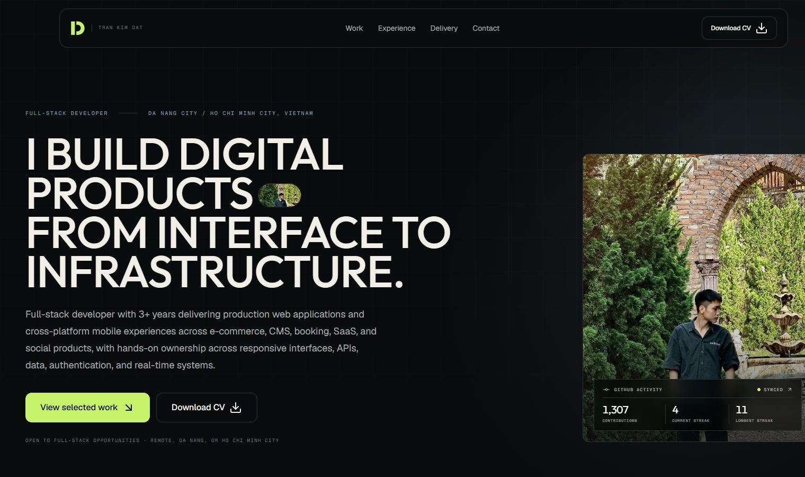
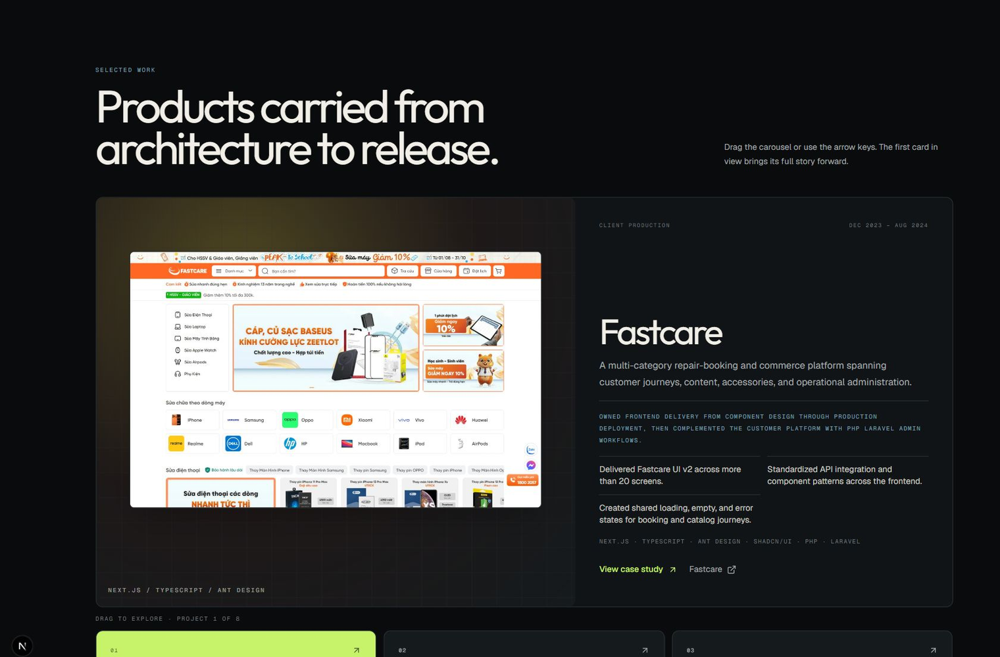
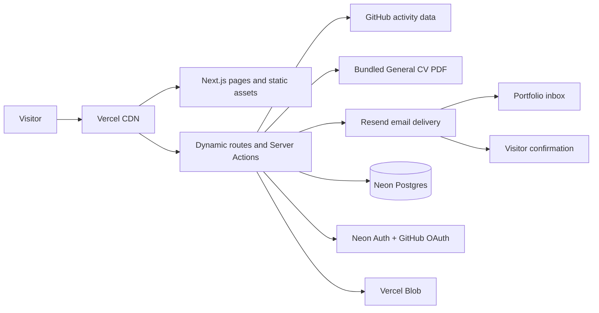

# Tran Kim Dat - Software Engineer Portfolio

[View the live portfolio](https://www.dattk.dev) · [Download the latest CV](https://www.dattk.dev/api/cv) · [LinkedIn](https://www.linkedin.com/in/kimdat0705/) · [GitHub](https://github.com/dattk2002)



## About this project

This is my personal full-stack portfolio: an editorial, responsive product experience built to show not only what I shipped, but also what I owned across interface design, application architecture, APIs, data, testing, containerization, and production delivery.

The site is organized around real project evidence. Each selected work item connects its product context, my responsibilities, measurable outcomes, technology choices, live deployments, and source repositories. The interface is intentionally interactive while remaining keyboard-accessible and respectful of reduced-motion preferences.

## What I built

- **Responsive editorial interface** — a custom dark visual system with fluid typography, asymmetric layouts, optimized WebP artwork, and layouts designed for phone, tablet, and desktop breakpoints.
- **Data-driven project portfolio** - thirteen case studies share typed content models and statically generated routes, keeping project details consistent across the homepage, experience timeline, and detail pages.
- **Gesture-based exploration** — the Selected Work carousel supports touch dragging, mouse dragging, card selection, and arrow-key navigation. The featured project surface can also be swiped directly on mobile.
- **Interactive professional timeline** — expandable project details, drag-to-scroll behavior, inertial movement, and automatic positioning expose deeper experience without turning the page into a long static résumé.
- **Scheduled GitHub activity** - a daily authenticated Vercel Cron job calculates contribution totals and streaks in Asia/Bangkok and stores the last successful snapshot in Neon, independently of browser visits. Public reads show the sync time and flag delayed updates.
- **Two-way contact workflow** — a validated server action sends the enquiry to me and a confirmation to the visitor through Resend. It includes Zod validation, subject sanitization, a honeypot, reply routing, and optional Upstash rate limiting.
- **Bundled CV delivery** - Download and Preview serve the same approved General PDF through `/api/cv`, as an attachment or inline document. The file is validated and bundled with the server route, with no external export dependency; replacing it requires a new build/deployment.
- **Search and sharing support** — canonical metadata, generated Open Graph artwork, `robots.txt`, and a project-aware sitemap are produced through Next.js conventions.
- **Localized publishing workspace** — a protected GitHub sign-in opens a Notion-inspired editor for English and Vietnamese articles, drafts, scheduled publishing, tags, SEO fields, cover images, and privacy-enhanced YouTube embeds.
- **Database-backed blog** — Neon Postgres and Drizzle persist structured editor JSON, localized URLs, publication state, and tags. Public article pages, RSS, sitemap entries, and cache invalidation stay inside the same Next.js deployment.

## Selected work experience



The portfolio currently documents work across Three.js, Fastify, Flutter, ASP.NET Core, NestJS, Next.js, React, Laravel, PostgreSQL, MongoDB, SignalR, Docker, and CMS-backed production systems. Project content lives in `lib/projects.ts`, while professional history and delivery evidence are maintained separately in `lib/experience.ts` and `lib/capabilities.ts`.

OathFront adds solo game-development ownership: a browser-based PvE card game in active development, with four Three.js battlefields, direct card dragging, a deterministic TypeScript engine and bots, and server-authoritative match persistence. Its homepage is the primary project image; desktop and mobile gameplay captures show the 3D battle interface.

Panda POS & Manager adds reservation/preorder forms, partial payments, invoice reprinting, revenue reporting, and NestJS/TypeORM finance and administrative APIs from DAN SOLUTIONS. Its ownership record distinguishes backend contributions in 2024 from frontend work in 2026. Gallery images are official iPad POS and kitchen-display product captures, not screenshots of authored web-app screens.

Freelance work from June 2026 includes Bravodemy, HuntingAlice, and Mystical Orb. Bravodemy separates frontend/backend-foundation ownership from a collaborator’s core lesson generation. HuntingAlice covers full-stack B2B research/campaign workflows; Mystical Orb covers bilingual reading and sharing interfaces. The two new case studies use public sign-in/homepage captures. Their year-only labels describe contribution year, not unconfirmed project start/end dates.

DAN SOLUTIONS is one continuous December 2023–May 2026 tenure, with separate intern and engineer role periods. FPT Software remains a distinct December 2022–April 2023 internship. FPT University is October 2020–September 2024, and the NgoaiNguNgay capstone is May–September 2024.

## How the portfolio works



The App Router keeps content-heavy pages statically generated where possible. Dynamic work is isolated behind server routes and Server Actions, so API credentials never need to enter the browser bundle.

## Production, domain, and Vercel CDN

The production deployment is available through the custom domain [`dattk.dev`](https://dattk.dev), which resolves to the canonical [`www.dattk.dev`](https://www.dattk.dev) deployment on Vercel.

Vercel places every deployment behind its global CDN. For this portfolio, that means:

- static pages, images, fonts, and framework assets can be delivered close to visitors;
- routing, compression, cache behavior, and deployment aliases are handled by the platform;
- dynamic endpoints such as GitHub statistics and CV delivery remain server-side while using explicit cache policies;
- the verified custom domain receives managed HTTPS and automatic SSL certificate provisioning;
- a production deployment can be replaced atomically without changing the public domain.

The CDN is not described here as a blanket cache for every request: static output is cacheable, while contact submissions and other dynamic behavior still execute securely on the server. See the official [Vercel CDN overview](https://vercel.com/docs/cdn) and [custom domain guide](https://vercel.com/docs/domains/set-up-custom-domain) for the platform behavior behind this deployment.

## Technology

| Area | Implementation |
| --- | --- |
| Framework | Next.js 16 App Router, React, TypeScript |
| Styling | Tailwind CSS, shadcn/ui conventions, Geist and Outfit |
| Motion | Framer Motion, GSAP, Embla Carousel, Embla Auto Scroll |
| Forms and email | React Server Actions, Zod, Resend |
| Content | Typed portfolio data, Tiptap blog editor, bundled General CV PDF |
| Blog data and auth | Neon Postgres, Drizzle ORM, Neon Auth, GitHub OAuth |
| Blog media | Vercel Blob client uploads |
| Media and SEO | `next/image`, generated Open Graph images, sitemap, robots |
| Hosting | Vercel production deployment, custom domain, Vercel CDN |
| Runtime | Node.js 24.x, Yarn 4.9.2 |

## Local development

```bash
corepack yarn install
Copy-Item .env.example .env.local
corepack yarn dev
```

Open `http://localhost:3000`.

### Environment variables

| Variable | Purpose | Exposure |
| --- | --- | --- |
| `NEXT_PUBLIC_SITE_URL` | Canonical origin used for metadata, sitemap, robots, and Open Graph URLs | Public config |
| `DATABASE_URL` | Pooled Neon Postgres connection used by the application | Secret, server only |
| `DATABASE_URL_UNPOOLED` | Direct Neon connection used by Drizzle migrations | Secret, local/CI only |
| `CRON_SECRET` | Authenticates the daily GitHub activity cron job | Secret, server only |
| `NEON_AUTH_BASE_URL` | Neon Auth project endpoint | Server config |
| `NEON_AUTH_COOKIE_SECRET` | Encrypts and signs authentication cookies | Secret, server only |
| `ADMIN_GITHUB_ACCOUNT_ID` | Immutable GitHub account ID allowed into the blog admin | Server config |
| `BLOB_READ_WRITE_TOKEN` | Vercel Blob credential for cover and inline image uploads | Secret, server only |
| `RESEND_API_KEY` | Authenticates server-side Resend requests | Secret, server only |
| `RESEND_FROM_EMAIL` | Verified sender, currently `Portfolio <contact@dattk.dev>` | Server config |
| `CONTACT_TO_EMAIL` | Destination for portfolio enquiries | Server config |
| `UPSTASH_REDIS_REST_URL` | Optional contact rate-limit backend | Server config |
| `UPSTASH_REDIS_REST_TOKEN` | Optional Upstash credential | Secret, server only |

For production, set `NEXT_PUBLIC_SITE_URL=https://www.dattk.dev`. Keep real credentials in `.env.local` and Vercel Environment Variables; never commit them.

### Daily GitHub sync

`vercel.json` schedules `/api/cron/github-stats` at `0 0 * * *`: daily at 00:00 UTC / 07:00 Vietnam. Cron runs without any browser or page visit. On Hobby, Vercel may invoke it within the 07:00–08:00 window.

Before enabling the new code in production:

1. Review pending migrations before running `corepack yarn db:migrate` against the intended database with `DATABASE_URL_UNPOOLED`. For a GitHub-only rollout, apply `drizzle/0002_github_activity_snapshots.sql` through a scoped migration so pending blog-content migrations are not published incidentally. This schema migration is idempotent, allowing the full journal to run later.
2. Set a random `CRON_SECRET` of at least 16 characters in Vercel's Production environment, then deploy. Vercel sends it as a Bearer authorization header.
3. Run the job once from Vercel's Cron Jobs dashboard to initialize the snapshot, then confirm a 200 response and the sync time in `/api/github-stats?v=3`. Until the first successful run, public activity shows unavailable.

The scheduler retries upstream requests up to three times within a run. A failed run preserves the last good snapshot; public reads flag it as delayed after the following scheduled run's one-hour invocation window. Vercel does not automatically retry a failed invocation: inspect its logs and rerun it from the dashboard if needed. Preview and local environments do not execute the production schedule. See [Vercel cron management](https://vercel.com/docs/schedules/cron-jobs/manage-cron-jobs).

## Quality checks

```bash
corepack yarn test
corepack yarn typecheck
corepack yarn lint
corepack yarn build
```

## Main routes

- `/` — portfolio home and project overview
- `/projects/[slug]` — statically generated project case studies
- `/blog` — published articles with locale filtering and visible tags
- `/blog/[locale]/[slug]` — localized article detail
- `/blog/rss.xml` — published article feed
- `/admin` — entry point that redirects to the owner sign-in
- `/admin/sign-in` — GitHub sign-in for the blog owner; authorization opens in a new tab
- `/admin/blog` — protected article management and editor
- `/api/cv` - approved bundled CV, downloaded or previewed inline
- `/api/github-stats` - reads the stored contribution/streak snapshot, sync times, and delayed status; does not contact GitHub
- `/api/cron/github-stats` - authenticated daily background sync into Neon
- `/opengraph-image` — generated social sharing image
- `/sitemap.xml` and `/robots.txt` — search-engine discovery

## Project structure

```text
app/                  App Router pages, metadata, Server Actions, and API routes
components/           Interface, navigation, motion, carousel, and form components
drizzle/              Versioned Neon Postgres migrations
lib/                  Portfolio content, database, blog, and authorization modules
public/images/        Optimized portraits, project artwork, and README screenshots
public/documents/     Approved General CV PDF
```

## Deployment

1. Import the repository into Vercel with the project root unchanged.
2. Use the Next.js framework preset, Yarn package manager, and Node.js `24.x`.
3. Add the variables documented in `.env.example` to the appropriate Production, Preview, and Development environments.
4. Create a public Vercel Blob store and connect it to the project so `BLOB_READ_WRITE_TOKEN` is available.
5. Add the Neon runtime/auth values and admin allowlist from `.env.example`. GitHub OAuth client credentials stay in Neon Auth and are not Vercel runtime variables.
6. Keep `RESEND_API_KEY`, database URLs, the auth cookie secret, and Blob token sensitive and server-only. `NEXT_PUBLIC_SITE_URL` is intentionally public configuration.
7. Verify `dattk.dev` in Resend and use a sending-only API key restricted to that domain.
8. Run `corepack yarn db:migrate` against the target database, deploy, then verify GitHub admin sign-in, image upload, draft/publish behavior, localized article URLs, RSS, sitemap, CV download, project routes, GitHub activity, and both contact emails.

No cookie banner is required unless analytics, advertising, or other non-essential tracking is added later.
